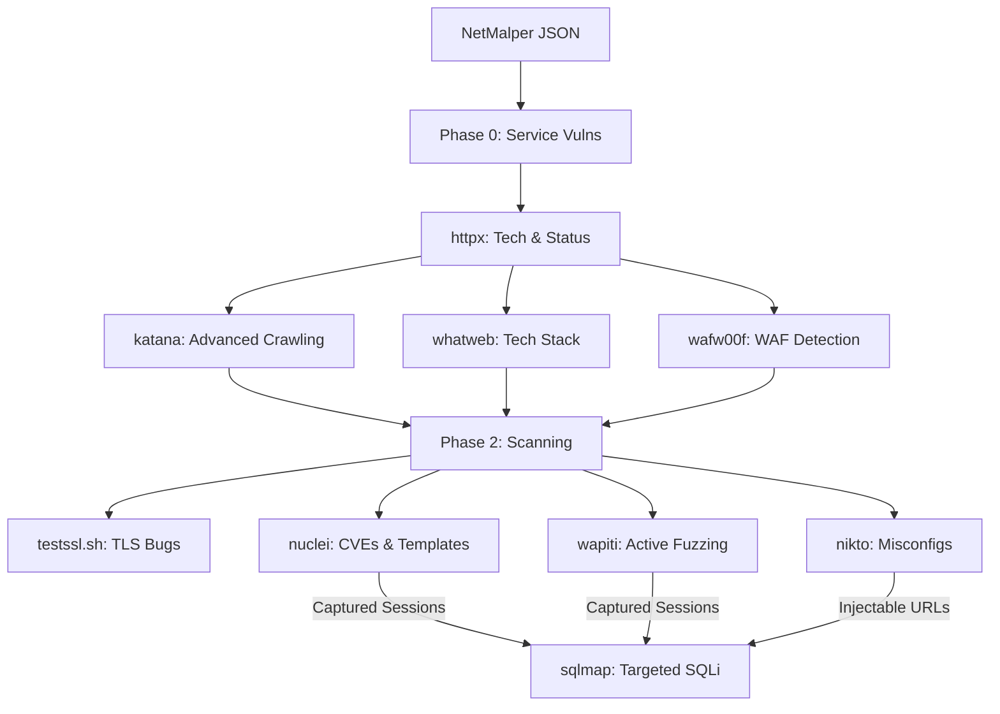

# VulnMalper

[](https://www.python.org/downloads/)
[](https://opensource.org/licenses/MIT)
[](https://github.com/MKMithun2806/VulnMalper/actions/workflows/ci.yml)
[](https://pypi.org/project/vulnmalper/)

VulnMalper is a single-file vulnerability pipeline for
[NetMalper](https://github.com/MKMithun2806/NetMalper) graphs. It orchestrates
a multi-stage security auditing workflow — **Fingerprint → Scan → Verify** —
where every stage intelligently feeds the next, ensuring maximum coverage
with no blind spraying.

It has **zero runtime dependencies** (Python standard library only) and runs
each tool locally when available, falling back to the tool's official Docker
image automatically.

## Features

- **Fingerprint → Scan → Verify pipeline** driven by a NetMalper JSON graph.
- **Auto-runner** (`--runner auto`, default): tools run locally if installed,
  otherwise via their official Docker image.
- **Session handover:** session cookies from successful `nuclei` or `wapiti`
  login findings are automatically passed to `sqlmap` for authenticated
  scanning.
- **Phase 0 service scanning:** non-web services are profiled with `nmap` and
  checked against `nuclei` templates.
- **Crawl + content discovery:** `katana` crawl discovery and `ffuf` /
  `feroxbuster` content discovery feed new targets back into the pipeline.
- **WAF awareness:** auto-detects WAFs and adjusts downstream behavior (e.g.
  SQLMap tamper scripts).
- **Stealth profiles:** randomized User-Agents, jittered headers/timing, and
  polite/slow rate-limiting to avoid simple pattern-based detection.
- **Proxy pool rotation:** load 2-15 proxies from a file with `--proxy-file`;
  tool launches rotate round-robin, and active proxy mode scales tool
  timeouts by 2.5x.
- **Targeted SQLi verification:** `sqlmap` runs only on injectable-looking
  endpoints surfaced by upstream stages — no blind spraying.
- **Clean output:** a single actionable **Markdown report**, a high-signal
  console summary, and optional JSON export.

## Pipeline



## Installation

VulnMalper requires Python 3.9 or newer. It is a self-contained module with
no runtime dependencies.

### With uv (recommended)

From PyPI:

```bash
uv tool install vulnmalper
```

From the repository:

```bash
uv tool install git+https://github.com/MKMithun2806/VulnMalper
```

Both install a `vulnmalper` executable:

```bash
vulnmalper --help
```

### With pip

```bash
pip install vulnmalper
```

### From source (no install)

```bash
git clone https://github.com/MKMithun2806/VulnMalper
cd VulnMalper
./vulnmalper.py --help
```

## Building platform packages

Each [GitHub release](https://github.com/MKMithun2806/VulnMalper/releases)
attaches a `.deb`, Python distributions (wheel + sdist), and a self-contained
Alpine Linux (musl) binary. They are built by the `release` workflow; the
scripts can also be run locally:

```bash
# Debian/Ubuntu .deb (requires dpkg-dev)
./build_deb.sh 7.3.6

# Alpine Linux (musl) one-file binary — run inside the official Alpine container
docker run --rm -v "$PWD":/work -w /work \
  alpine:3.21 sh -c "apk add --no-cache python3 py3-pip gcc musl-dev python3-dev binutils curl ca-certificates >/dev/null 2>&1 && sh build_alpine.sh"

# Windows EXE (requires PowerShell + Nuitka)
powershell -File build_exe.ps1
```

Install the `.deb` with:

```bash
URL=$(curl -s https://api.github.com/repos/MKMithun2806/VulnMalper/releases/latest | grep browser_download_url | grep .deb | cut -d '"' -f 4)
curl -L -o vulnmalper.deb "$URL"
sudo apt install -y ./vulnmalper.deb
rm vulnmalper.deb
```

Install the Alpine binary with:

```bash
wget -O /usr/local/bin/vulnmalper https://github.com/MKMithun2806/VulnMalper/releases/latest/download/vulnmalper-v7.3.6-alpine-musl
chmod +x /usr/local/bin/vulnmalper
```

### External tool dependencies

VulnMalper pulls official Docker images for any tool that isn't found locally.
For fully local execution, install the tools yourself:

```bash
sudo apt install nikto sqlmap whatweb wafw00f
pip install wapiti3
# Go-based tools
go install github.com/projectdiscovery/httpx/cmd/httpx@latest
go install github.com/projectdiscovery/nuclei/v3/cmd/nuclei@latest
go install github.com/projectdiscovery/katana/cmd/katana@latest
```

## Usage

```bash
# Basic run with a NetMalper graph
vulnmalper targets.json

# Authenticated scan with session handover
vulnmalper targets.json --auth-user admin --auth-pass password123

# Focused scan with high severity only
vulnmalper targets.json --only nuclei,sqlmap --severity high

# Polite, rate-limited scan
vulnmalper targets.json --polite --rate-limit 10

# Scan through a rotating proxy pool
vulnmalper targets.json --proxy-file proxies.txt

# Also write a JSON export next to the Markdown report
vulnmalper targets.json --export-json
```

A sample NetMalper graph is provided at `examples/targets.json`.

### Key flags

| Flag | Description |
| :--- | :--- |
| `--runner` | `auto` (default), `local`, or `docker`. |
| `--only` | Comma-separated list of tools to run. |
| `--threads` | Number of parallel per-target workers (default: 3). |
| `--severity` | Minimum nuclei severity to report (`info`, `low`, `medium`, `high`, `critical`). |
| `--max-targets` | Cap the number of targets processed. |
| `--proxy-file` | File with one proxy per line (`http://host:port` or `socks5://host:port`); 2-15 proxies rotated round-robin. |
| `--auth-user`, `--auth-pass`, `--auth-cookie` | Credentials for authenticated scanning. |
| `--out` | Custom base name for the Markdown report. |
| `--export-json` | Also write a JSON export (bare flag auto-names it next to the report). |

### Stealth / polite-mode flags

| Flag | Description |
| :--- | :--- |
| `--polite` | Cap req/sec, add ~250ms delays, use browser headers. |
| `--slow` | Very low req/sec, ~1s delays, Nikto `-Pause 1`; use against WAF-protected targets. |
| `--user-agent` | Pin a single User-Agent (default: random per run). |
| `--header` | Extra HTTP header, repeatable (e.g. `--header 'X-Forwarded-For: 1.2.3.4'`). |
| `--rate-limit` | Hard cap on req/sec for nuclei/httpx (0 = tool default). |
| `--delay-ms` | Minimum ms between requests for tools that support it. |
| `--headless` | Enable nuclei `-headless` (Chromium) for JS-rendered endpoints. |
| `--quiet` | Drop noisy nuclei tags and exposure-config globs; implied by `--polite`/`--slow`. |
| `--no-jitter` | Disable per-request randomisation of timing and headers. |

If no stealth flag is given, **auto mode** is enabled: a per-target strategy
(stealth / balanced / aggressive) is chosen after Phase 1 based on evidence
(WAF/CDN → stealth, private IP → aggressive, else balanced).

### Per-tool timeouts

Each tool has its own `--<tool>-timeout` flag (seconds), e.g. `--nuclei-timeout`,
`--sqlmap-timeout`. Use `--no-timeout` to lift caps (see `vulnmalper --help`).

## Development

See [CONTRIBUTING.md](CONTRIBUTING.md) for the full guide.

```bash
git clone https://github.com/MKMithun2806/VulnMalper
cd VulnMalper

uv sync                                   # create env, install package + dev tools
uv run pytest                             # run tests
uv run ruff check .                       # lint
uv run ruff format --check .              # formatting
 uv run python vulnmalper.py --help        # smoke test
```

## Documentation

- [Pipeline details](docs/PIPELINE.md)
- [Changelog](CHANGELOG.md)
- [Contributing](CONTRIBUTING.md)
- [Security policy](SECURITY.md)

## License

MIT © [MKMithun](https://github.com/MKMithun2806)

Pairs perfectly with [NetMalper](https://github.com/MKMithun2806/NetMalper).
